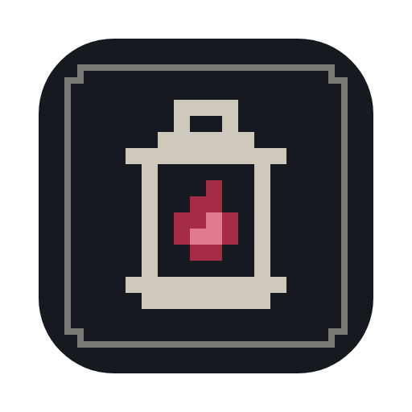

<p align="center"></p>

# Runehaven Mac Launcher

Play the Windows version of [Runehaven](https://store.steampowered.com/app/2676030/) on Apple Silicon Macs. Project by Starwatcherr.

> **Unofficial.** Not made, affiliated with or endorsed by Cikoria Studio. You need your own copy of Runehaven on Steam.

**Status:** beta. It works on the developer's Mac; please report anything that does not work for you.

## What it does

- Installs everything Runehaven needs with one button: Rosetta 2, the Windows version of the game through your own Steam, and a Wine runtime with DXMT (Direct3D 11 → Metal).
- Starts the game in macOS full screen, with a fix for mouse input that Unity games need under Wine.
- Keeps things in order: update, verify or uninstall the game, update or set Wine up again, move the game to another Steam library, export logs for bug reports.
- Backs up your save games before a start when they have changed, and tells you when a new launcher version is out.

## Requirements

- A Mac with Apple Silicon (M1 or newer) and macOS 14 or newer
- [Steam](https://store.steampowered.com/about/) for Mac, signed in, with Runehaven in your library
- About 2 GB of free space: game 330 MB, Wine runtime 1.1 GB (376 MB download), Wine setup about 350 MB

## Install

1. Download `Runehaven-Mac-Launcher_<version>_aarch64.dmg` from [Releases](../../releases).
2. Open it and drag **Runehaven Mac Launcher** into **Applications**.
3. Open the app. Because the beta is not notarized by Apple, macOS stops it the first time:
   - Click **Done** in the warning.
   - Open **System Settings → Privacy & Security**, scroll down to the message about Runehaven Mac Launcher and click **Open Anyway**.
   - Confirm with your password. From then on the app opens normally.
   - If the app only keeps bouncing in the Dock and no window opens, macOS could not finish its online check of the app (some networks block it). Force-quit it (right-click in the Dock), run this once in Terminal and open it again:
     ```
     xattr -dr com.apple.quarantine "/Applications/Runehaven Mac Launcher.app"
     ```

## First start

1. The home page lists what Runehaven needs. Click **Install requirements**.
   - **Rosetta 2:** macOS asks for your password in its own window.
   - **Runehaven:** the launcher asks your Steam to download the Windows version. For this, Steam is switched to Windows for a few seconds and then back.
   - **Wine runtime:** downloaded from its original sources and checked before use.
2. Click **Launch Game**. The very first start, and the first start after an update of the launcher, can take up to a minute.

Hover over the button while the game runs to **Exit Runehaven**. Exiting from the game's own menu is better, so your progress is saved.

Want things somewhere else? **Custom…** next to Install requirements (or **Settings → Install locations**) chooses the Steam library, a folder for the Wine runtime, or a Wine runtime or Wine setup (for example a Whisky or CrossOver bottle) you already have.

## Your save games

They live in the launcher's Wine setup: `~/Library/Application Support/Runehaven Launcher/prefix`. Before a start, if they have changed, the launcher packs them into a ZIP in `backups/saves` next to it. It keeps the last 10, and of older ones one per day for two weeks; **Maintenance → Save games** opens both folders. **Maintenance → Remove launcher data** and **Uninstall Runehaven Mac Launcher** pack them into a ZIP on your desktop before anything is deleted.

## Known issues

- Controllers do not work yet.
- Trackpad scrolling: slow swipes barely scroll, fast ones scroll a lot. A mouse wheel works fine.
- Opening the in-game graphics menu switches the game to full screen at 1280 × 720. Switching back to window mode works.
- Not tested yet: Steam features such as achievements and cloud saves, and multiplayer.

## Problems and bug reports

**Settings → Debug → Export** puts everything a bug report needs (logs of the last starts, crash reports, a system check, the settings) into one ZIP on your desktop. Please attach it when you report a problem. Problems with Runehaven itself also happen on Windows; those go to the game's developers.

## How it works

1. Steam on macOS does not install Windows-only games. The launcher sends your Steam a few console commands: switch to Windows, install or update Runehaven, switch back. Steam keeps the game updated from then on and never needs your login details from the launcher.
2. The game runs through Wine ([WineCX 24.0.7](https://github.com/Sikarugir-App/Engines)) with [DXMT 0.80](https://github.com/3Shain/dxmt) and Rosetta 2.
3. A small input fix (`version.dll` next to the game) gives Unity the raw mouse input it expects, which Wine does not provide yet. A small Mac helper switches the game window into macOS full screen and keeps the game's cursor.

The launcher sends no data anywhere. It talks to your Steam, downloads the Wine runtime from GitHub and asks GitHub whether a new launcher version is out (**Settings → Check for launcher updates** turns that off).

## Building from source

Requires macOS with the Xcode command line tools, [Rust](https://rustup.rs) and the Tauri CLI (`cargo install tauri-cli --version "^2"`). The input fix needs a MinGW-w64 compiler (`brew install mingw-w64`).

```sh
scripts/build-app.sh
```

The app and the DMG end up in `target/release/bundle/`. `cargo test` runs the tests.

The command-line tool `rml` uses the same core and is handy for testing:

| Command | What it does |
|---|---|
| `rml doctor` | Checks the Mac, Rosetta, Steam and the game |
| `rml game install`, `verify`, `uninstall`, `move --library N` | Installs, checks, removes or moves the game through Steam |
| `rml game launch` | Starts the game |
| `rml runtime install` | Downloads the Wine runtime |
| `rml steam recover` | Switches Steam back to macOS after an interrupted install |
| `rml config show` / `set` | Shows or changes the settings |

## Credits

- [Wine](https://www.winehq.org), [Sikarugir](https://github.com/Sikarugir-App) WineCX builds, [Gcenx](https://github.com/Gcenx) macOS Wine builds
- [DXMT](https://github.com/3Shain/dxmt) by Feifan He for CodeWeavers
- [Tauri](https://tauri.app)
- [kaon](https://github.com/natbro/kaon) for documenting Steam's platform override on macOS
- Fonts: Jacquard 24, Pixelify Sans, Figtree (SIL Open Font License)
- Runehaven by Cikoria Studio; the background screenshot is used with their permission

## License

GNU General Public License, version 3 or later, see [LICENSE](LICENSE), with additional terms: the credit "Project by Starwatcherr" stays visible, and the name and logo are not licensed, so distributed forks need their own. The logo, the app icon, the Runehaven screenshot and the fonts are under other terms. Details in [NOTICE.md](NOTICE.md).

Runehaven itself and its assets belong to Cikoria Studio.
